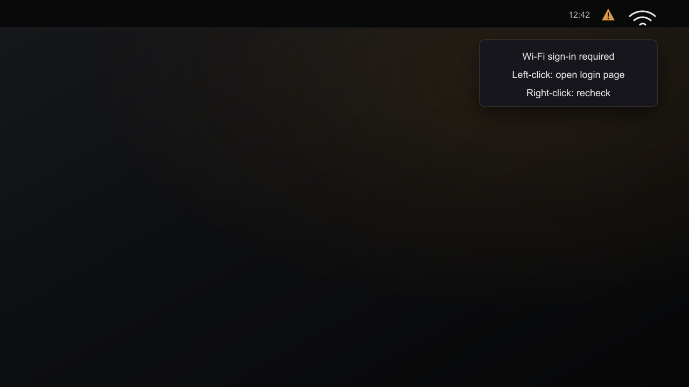

# Portal Prompt

An [Omarchy](https://omarchy.org/) Quattro bar widget that shows when NetworkManager reports a captive portal or limited connectivity, then opens a browser sign-in page.



Portal Prompt stays hidden while connectivity is normal. When NetworkManager reports `portal` or `limited`:

- **Left-click** opens the sign-in page.
- **Right-click** rechecks connectivity.

## Install

```bash
omarchy plugin add https://github.com/blackscaletech/portal-prompt.git --enable
```

The widget is added to the right side of the bar. Its optional `loginUrl` setting defaults to `http://example.com/`; plain HTTP allows the network to redirect the browser to its portal.

## Remove

```bash
omarchy plugin remove io.github.blackscaletech.portal-prompt
```

## Requirements

- Omarchy Quattro with NetworkManager
- `nmcli` and `xdg-open`, both included by Omarchy

## Security and privacy

Portal Prompt runs `nmcli` for connectivity status and opens one validated HTTP URL with `xdg-open`. It requests no privileges and reads no credentials. It stores no data and includes no telemetry or downloaded dependencies.

## License

[MIT](LICENSE)
